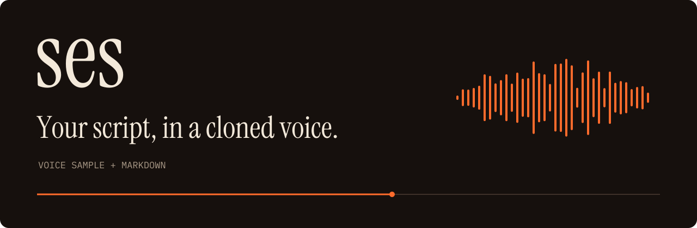

# ses



ses, Turkish for "voice", turns a markdown script and a short voice sample into
narration in that voice. Each section of the script becomes its own WAV, and the
whole script is joined into `full.wav`. It runs
[Qwen3-TTS](https://huggingface.co/Qwen/Qwen3-TTS-12Hz-0.6B-Base) on your machine
and retries takes that come out with a garbled loud burst or long dead air, so
you don't have to catch those by ear and re-render them yourself.

- **Local.** It uses Metal (MPS) when PyTorch reports it, and the CPU
  otherwise. Once the first run has downloaded the weights, it works offline.
- **Self-checking.** ses regenerates garbled sentences and re-renders any section
  with more than 850 ms of dead air inside it, up to twice each. If
  [LavaSR](https://github.com/ysharma3501/LavaSR) enhancement adds
  high-frequency hash, ses keeps the clean raw take instead.
- **Even pacing.** It synthesizes one sentence at a time, then joins sentences
  with 170 ms of silence, paragraphs with 360 ms, and sections with 600 ms.
  Loudness is leveled per section after enhancement.
- **Fix one section.** Edit a line and re-render just that section with
  `--slide N`.
- **Common audio formats.** Samples can be WAV, FLAC, OGG, AIFF, or MP3. For
  m4a, AAC, and Opus, ses falls back to SoX, which needs a build with those
  codecs. Add a transcript of the sample and ses switches to in-context cloning,
  which follows the voice more closely.
- **Copyable.** The DSP, quality checks, chunking, and parsing modules need only
  numpy. Lift one into your project, or swap the TTS engine behind a two-method
  `Protocol`.

Write narration as `>` quotes under timestamped headings:

```markdown
## 0:00 — Welcome

> Welcome to ses, a voiceover pipeline. This tool turns a written script into
> narrated audio using a short sample of your own voice.
```

Render it with a voice sample from `in/`:

```sh
python -m ses --script examples/script.md --sample my_voice --chunk-timeout-sec 0
# 0 disables the 180s deadline. On CPU that deadline includes model load.
# audio/20261109-211209/
#   slide-00-welcome.wav        # enhanced, 48 kHz
#   slide-00-welcome.raw.wav    # the same take before enhancement
#   slide-01-how-it-works.wav
#   ...
#   full.wav                    # every section, 600 ms apart
```

## See it in motion

https://github.com/user-attachments/assets/6c3544dc-8800-4a78-ac6f-687cf8141416

## Contents

- [Getting started](#getting-started)
- [Options](#options)
- [Script format](#script-format)
- [Copying a module into your project](#copying-a-module-into-your-project)
- [Adapting the TTS engine or enhancer](#adapting-the-tts-engine-or-enhancer)
- [Architecture](#architecture)
- [Visual identity and product film](#visual-identity-and-product-film)
- [License](#license)

---

## Getting started

These steps cover macOS with Homebrew and Ubuntu 24.04. ses isn't a pip
package, so run every `python -m ses` command from the repo root with the venv
active.

**1. Install system packages.** ses needs Python 3.12 and git, and qwen-tts runs
the `sox` command.

```sh
# macOS
brew install python@3.12 git sox

# Ubuntu 24.04
sudo apt update && sudo apt install python3.12 python3.12-venv git sox
```

**2. Clone and install.**

```sh
git clone https://github.com/apphane-dev/ses.git
cd ses
python3.12 -m venv .venv
source .venv/bin/activate
pip install -r requirements.txt
```

> On Linux, pip downloads about 3.2 GB, mostly the CUDA libraries that ship with
> PyTorch. ses doesn't use them. Off a Mac it runs on the CPU.

**3. Add a voice sample.** Copy a recording into `in/`. Its file name without
the extension becomes the sample name.

```sh
mkdir -p in
cp /path/to/your-recording.wav in/my_voice.wav
```

For better cloning, save the exact words spoken in the recording as
`in/my_voice.txt`.

**4. Check that the script parses.** `--dry-run` lists the sections and loads no
model.

```sh
python -m ses --script examples/script.md --dry-run
# Parsed 3 slide sections from script.md
#   [00] Welcome  (271 chars)
#   [01] How it works  (302 chars)
#   [02] Getting started  (252 chars)
# -- dry run, no audio generated --
```

**5. Render.**

```sh
python -m ses --script examples/script.md --sample my_voice --chunk-timeout-sec 0
```

> **The first render downloads the model weights** from Hugging Face. The
> Qwen3-TTS repo is 2.5 GB and LavaSR's is 0.1 GB. Later runs use the cache.
>
> On CPU, keep `--chunk-timeout-sec 0`. The default 180 second deadline includes
> the first model load. On Ubuntu 24.04 that load ran past the deadline, ses
> tried the first sentence three times, and wrote no WAV. `0` turns the
> deadline off.

ses prints a summary with each section's length and the run folder. Play
`full.wav` from that folder to hear the whole script.

**6. Write your own script.** Copy `examples/script.md` to `script.md` and edit
it. Without `--script`, ses reads `script.md` from the current directory. To
redo one section, pass its index from the dry run:

```sh
python -m ses --sample my_voice --slide 1 --chunk-timeout-sec 0
```

`--slide` writes that one section to a new run folder and skips `full.wav`.
On CPU, keep the same timeout flag. The default still gives up during model load.

## Options

| Flag | Default | Effect |
| --- | --- | --- |
| `--script PATH` | `script.md` | Markdown script to narrate. |
| `--sample NAME` | ask | Sample file name without extension. With one sample in the folder, ses picks it; with several, it asks. |
| `--samples-dir PATH` | `in/` | Folder of voice samples. If it has none, ses looks in [`examples/voices/`](examples/voices/). |
| `--out-dir PATH` | `audio/` | Each run writes to a new `YYYYMMDD-HHMMSS/` folder inside it. |
| `--slide N` | all | Render only section `N`, counting from 0. No `full.wav`. |
| `--dry-run` | off | Parse and list sections. No model, no audio. |
| `--no-enhance` | off | Skip LavaSR and keep the raw takes. |
| `--chunk-timeout-sec N` | `180` | Seconds before retrying a sentence. The clock includes the first model load. `0` disables it. On CPU, pass `0`. |
| `--chunk-retries N` | `2` | Retries per sentence after a failure, timeout, or garbled take. |
| `--show-backend-warnings` | off | Show the qwen-tts and transformers warnings ses hides. |

Everything else, including silence lengths, quality thresholds, temperature, and
language, lives in `PipelineConfig` in [`ses/config.py`](ses/config.py). The CLI
uses its defaults, so it narrates in English.

## Script format

A section starts with `## <timestamp> — <Title>`. The timestamp is digits and
colons, like `0:00` or `1:23`, and the dash can be an em dash, en dash, or
hyphen. Narration goes in `>` quoted lines under the heading.

```markdown
## 0:00 — Welcome

> First paragraph. Sentences are split and synthesized one at a time
> for stable prosody.
>
> A blank `>` line starts a new paragraph, which gets a slightly longer pause.

## 0:20 — Next section

> TODO
> Standalone TODO / REDO / WIP / DRAFT lines are skipped, so you can leave
> notes in place without them being narrated.
```

- The heading text becomes the WAV name: `Next section` turns into
  `slide-01-next-section.wav`.
- Consecutive `>` lines join into one paragraph. A blank `>` line or any
  non-quote line ends it.
- ses skips a `>` line that is only `TODO`, `REDO`, `WIP`, `DRAFT`, `TBD`, or a
  run of dots or asterisks.
- A trailing `- TODO`, `- WIP`, and so on is stripped from a heading before it
  becomes a file name.
- A section with no narration is dropped, and the sections after it move up an
  index.

[`examples/script.md`](examples/script.md) is a complete example.

---

## Copying a module into your project

You don't have to take the whole pipeline. The DSP, quality checks, chunking, and
parsing modules depend only on numpy, so you can copy one into your own code.

To take just the trim, fade, and normalize helpers along with the garble, pause,
and noise detectors:

```sh
mkdir -p yourproject/audio
cp ses/audio/__init__.py ses/audio/dsp.py ses/audio/quality.py yourproject/audio/
pip install numpy
```

[`docs/DESIGN.md`](docs/DESIGN.md) lists every module and what it depends on.

## Adapting the TTS engine or enhancer

The quality checks are tuned to Qwen3-TTS and LavaSR. You can still swap either
one: a different engine works, but expect to retune the garble, pause, and noise
thresholds in `PipelineConfig`.

An engine implements [`ses/tts/base.py`](ses/tts/base.py) and an enhancer
implements [`ses/enhance/base.py`](ses/enhance/base.py):

```python
class TTSEngine(Protocol):  # ses/tts/base.py
    def synthesize(self, text: str, sample: VoiceSample) -> tuple[np.ndarray, int]: ...
    def close(self) -> None: ...

class Enhancer(Protocol):   # ses/enhance/base.py, optional
    def enhance(self, audio: np.ndarray, sr: int) -> tuple[np.ndarray, int]: ...
```

There is no plugin registry. Construct your class and pass it to `run_pipeline`:

```python
from pathlib import Path

import numpy as np

from ses import PipelineConfig, VoiceSample, run_pipeline

class MyTTS:
    def __init__(self):
        import my_tts_lib               # heavy import stays inside the adapter
        self.model = my_tts_lib.load()

    def synthesize(self, text: str, sample: VoiceSample) -> tuple[np.ndarray, int]:
        audio = self.model.clone(text, ref_wav=str(sample.audio))
        return np.asarray(audio, dtype=np.float32), self.model.sample_rate

    def close(self) -> None:
        pass

run_pipeline(
    script_text=Path("script.md").read_text(),
    sample=VoiceSample(
        name="my_voice",
        audio=Path("in/my_voice.wav"),
        transcript=Path("in/my_voice.txt"),   # or None for x-vector-only cloning
    ),
    out_dir=Path("audio/manual-run"),
    config=PipelineConfig(),
    engine=MyTTS(),
    enhancer=None,                             # skip enhancement, or pass your own
)
```

`run_pipeline` also takes `parser=`, a `ScriptParser` that defaults to the
markdown parser, and `sections_filter=N` to render one section. To pick samples
from a folder instead of building `VoiceSample` by hand, use
`find_samples(in_dir)` and `choose_sample(samples, name, in_dir)` from
`ses.samples`.

Import heavy libraries such as `torch` inside the adapter's methods. That keeps
the DSP, parsing, chunking, and quality modules importable with numpy alone.

## Architecture

[`docs/DESIGN.md`](docs/DESIGN.md) covers the module map, contracts, why each
quality check exists, and the testing policy. To contribute, see
[`docs/CONTRIBUTING.md`](docs/CONTRIBUTING.md).

---

## Visual identity and product film

The [ses identity](brand/README.md) has the palette, self-hosted fonts, wordmark,
waveform icon, README banner, and sharing card. The same tokens drive the
landing page and the [fframes film](marketing/film/README.md). The marketing
tools are separate from the Python pipeline.

## License

MIT. See [LICENSE](LICENSE).
